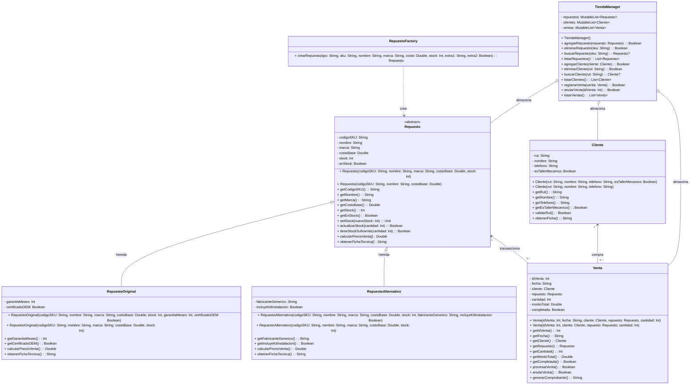

# AutopartesPro: Sistema de Gestión de Repuestos y Ventas Automotrices

## Integrantes

| Integrante | Rol en el grupo | Secciones que redactó |
|---|---|---|
| Vicente González | Coordinador de modelo | Modelo UML de clases, Herencia y abstracción |
| Gonzalo Fuenzalida | Redactor | Problema a resolver, Usuarios del sistema y Entidades principales |
| Matías Saldías | Analista de rúbrica y datos | Relaciones entre entidades, Datos de ejemplo y Manejo de errores |
| Franco Gajardo | Portavoz y custodio de la entrega | Operaciones del REPL, Patrón de diseño y Plan de avances |

Sección de laboratorio: 2 (Jueves)

---

## Problema que quieren resolver (obligatoria)

En las distribuidoras de repuestos y locales comerciales del rubro automotriz, el mesón de atención recibe diariamente a decenas de mecánicos y propietarios de vehículos que requieren piezas de recambio de manera urgente. La oferta de repuestos se divide fundamentalmente en componentes originales (OEM), que garantizan especificaciones exactas del fabricante y garantías extendidas, y piezas alternativas o genéricas, que compiten por menor costo pero requieren evaluar tolerancias, compatibilidad y kits de montaje universal.

Actualmente, los encargados de bodega y vendedores de mesón gestionan el inventario y las consultas comerciales mediante hojas de cálculo (Excel) desactualizadas y registros manuscritos en cuadernos de mesón. Esta falta de integración provoca continuos errores humanos: descalces entre el stock registrado y las existencias físicas en bodega, cotizaciones con precios erróneos al confundir los márgenes comerciales de piezas genuinas con piezas genéricas, y despachos equivocados que conllevan devoluciones recurrentes y retrasos críticos en los talleres de reparación.

AutopartesPro reemplaza estos registros dispersos por un sistema centralizado de gestión por consola interactiva (REPL) en memoria, permitiendo registrar repuestos, clientes y ventas. El sistema calcula de forma dinámica y polimórfica el precio de venta final de acuerdo con el tipo de repuesto (original o alternativo), valida la disponibilidad de inventario en tiempo real, procesa órdenes de venta descontando stock y mantiene la trazabilidad comercial de cada transacción.

**Alcance de esta versión:**
- Gestión en memoria para las entidades principales: repuestos (originales y alternativos), clientes (particulares y talleres) y ventas.
- Carga inicial automática de datos desde archivos de texto plano (`repuestos.txt`, `clientes.txt`, `ventas.txt`).
- Interfaz interactiva de consola (REPL) con operaciones completas de consulta, creación y eliminación segura para cada entidad.
- Manejo robusto de excepciones y validaciones de formato mediante bloques `try-catch` que garantizan la ejecución continua ante errores del usuario.

**Fuera de alcance:**
- Persistencia de modificaciones en bases de datos relacionales o reescritura automática de los archivos de texto al cerrar.
- Integración con pasarelas de pago online o terminales POS.
- Facturación electrónica y emisión de documentos tributarios ante el Servicio de Impuestos Internos (SII).
- Lectura óptica directa mediante lectores de código de barras físico.

---

## Usuarios del sistema (obligatoria)

| Usuario | Tarea en el sistema |
|---|---|
| Jefe de bodega | Utiliza las opciones de creación y eliminación para dar de alta nuevos ingresos de repuestos (especificando si son originales OEM o alternativos), actualizar niveles de stock y dar de baja piezas dañadas o descontinuadas del catálogo. |
| Vendedor de mesón | Consulta el catálogo con los precios de venta calculados automáticamente según el margen comercial del repuesto, verifica disponibilidad inmediata en bodega y procesa órdenes de compra para clientes o talleres mecánicos. |
| Administrador de local | Registra y gestiona la base de clientes y talleres mecánicos autorizados, consulta el historial de ventas y reportes consolidados de recaudación, y anula ventas en caso de devoluciones justificadas. |

*Nota: La versión de consola no implementa autenticación ni perfiles de acceso con contraseñas. Los roles presentados describen la perspectiva operacional y el propósito de cada opción del menú interactivo.*

---

## Entidades principales

### Repuesto (Clase base abstracta)
Representa de forma general a cualquier pieza o componente automotriz disponible en el inventario comercial. Se identifica unívocamente por su código alfanumérico SKU (ej. `"OEM-101"`, `"ALT-201"`). Registra su nombre comercial descriptivo, la marca fabricante, su costo base de adquisición en pesos chilenos, la cantidad de unidades físicas disponibles en bodega (`stock`) y un indicador booleano de disponibilidad (`enStock`). Define el contrato abstracto para el cálculo polimórfico del precio final de venta y la generación de fichas técnicas.

### RepuestoOriginal (Especialización de Repuesto)
Modela un repuesto genuino fabricado u homologado directamente por la marca automotriz del vehículo. Hereda todos los atributos de `Repuesto` y añade:
- `garantiaMeses`: número entero que indica el período de garantía extendida otorgada por fábrica (ej. 12, 24 meses).
- `certificadoOEM`: valor booleano que certifica que el componente cuenta con sello de trazabilidad de fábrica original.
Su precio final de venta aplica un margen comercial del 45% sobre el costo base, más un recargo fijo de $15.000 por concepto de certificación y póliza de garantía extendida.

### RepuestoAlternativo (Especialización de Repuesto)
Modela un repuesto genérico producido por empresas fabricantes de autopartes compatibles. Hereda los atributos generales de `Repuesto` y añade:
- `fabricanteGenerico`: nombre o razón social del fabricante de la pieza compatible (ej. `"Taiwan Auto Parts"`, `"MegaPower Corp"`).
- `incluyeKitInstalacion`: valor booleano que señala si la pieza viene acompañada de adaptadores, pernos o sellos para montaje universal.
Su precio final de venta aplica un margen comercial más competitivo del 25% sobre el costo base, adicionando $4.500 si incluye el kit de montaje universal.

### Cliente
Representa a la persona natural o empresa que adquiere piezas en el mesón de venta. Se identifica unívocamente por su RUT (formato chileno con dígito verificador). Registra su nombre completo o razón social, teléfono de contacto y un indicador booleano (`esTallerMecanico`). Los talleres mecánicos registrados cuentan con convenios para órdenes recurrentes y resúmenes de facturación mensual.

### Venta
Representa la transacción comercial u orden de compra cerrada en el mesón. Se identifica mediante un número correlativo entero único (`idVenta`, ej. `1001`). Registra la fecha de emisión en formato texto (`DD-MM-AAAA`), la referencia al cliente comprador, la referencia al repuesto adquirido, la cantidad de unidades vendidas, el monto total liquidado (calculado multiplicando la cantidad por el precio de venta unitario polimórfico del repuesto) y un estado booleano (`completada`) que garantiza que el stock en bodega fue rebajado correctamente.

---

## Relaciones entre entidades

- **`RepuestoOriginal` y `RepuestoAlternativo` con `Repuesto`:** Relación de generalización/especialización (herencia). Ambas clases hijas extienden a la clase abstracta `Repuesto`, reutilizando sus propiedades estructurales y sobreescribiendo el método polimórfico de cálculo de precio de venta.
- **`Cliente` con `Venta`:** Asociación simple. Un `Cliente` realiza de cero a muchas (`0..*`) `Ventas` a lo largo del tiempo, y cada `Venta` pertenece a exactamente un (`1`) `Cliente`.
- **`Venta` con `Repuesto`:** Asociación directa. Cada `Venta` transacciona exactamente un (`1`) tipo de `Repuesto` por ítem de registro, mientras que un `Repuesto` puede estar presente en cero o muchas (`0..*`) `Ventas` registradas en el historial.
- **`TiendaManager` con `Repuesto`, `Cliente` y `Venta`:** Relación de agregación / contenedor. La clase controladora `TiendaManager` mantiene colecciones (`MutableList`) de repuestos (`0..*`), clientes (`0..*`) y ventas (`0..*`), orquestando la búsqueda, validación y persistencia en memoria.
- **`RepuestoFactory` con `Repuesto`:** Relación de dependencia creacional. La fábrica recibe los parámetros del archivo o del usuario e instancia la subclase concreta correspondiente (`RepuestoOriginal` o `RepuestoAlternativo`), retornando una referencia abstracta de tipo `Repuesto`.

---

## Modelo UML de clases (obligatoria)


### Representación gráfica en Mermaid



---

### Tablas de especificación de clases

#### 1. Clase Abstracta: `Repuesto`
- **Constructor Primario:** `(codigoSKU: String, nombre: String, marca: String, costoBase: Double, stock: Int)`
- **Constructor Secundario:** `constructor(codigoSKU: String, nombre: String, costoBase: Double)` — Asigna marca `"Genérica"`, stock `0` y `enStock = false`.

| Propiedades (visibilidad, nombre, tipo) | Métodos (visibilidad, nombre, parámetros, retorno) |
|---|---|
| `- codigoSKU: String` | `+ getCodigoSKU(): String` |
| `- nombre: String` | `+ getNombre(): String` |
| `- marca: String` | `+ getMarca(): String` |
| `- costoBase: Double` | `+ getCostoBase(): Double` |
| `- stock: Int` | `+ getStock(): Int` |
| `- enStock: Boolean` | `+ getEnStock(): Boolean` |
| | `+ setStock(nuevoStock: Int): Unit` |
| | `+ actualizarStock(cantidad: Int): Boolean` |
| | `+ tieneStockSuficiente(cantidad: Int): Boolean` |
| | `+ calcularPrecioVenta(): Double` *(abstracto)* |
| | `+ obtenerFichaTecnica(): String` *(abstracto)* |

#### 2. Subclase: `RepuestoOriginal`
- **Constructor Primario:** `(codigoSKU: String, nombre: String, marca: String, costoBase: Double, stock: Int, garantiaMeses: Int, certificadoOEM: Boolean)`
- **Constructor Secundario:** `constructor(codigoSKU: String, nombre: String, marca: String, costoBase: Double, stock: Int)` — Asigna por defecto garantía de `12` meses y `certificadoOEM = true`.

| Propiedades (visibilidad, nombre, tipo) | Métodos (visibilidad, nombre, parámetros, retorno) |
|---|---|
| *(Heredadas de Repuesto)* | *(Heredadas de Repuesto)* |
| `- garantiaMeses: Int` | `+ getGarantiaMeses(): Int` |
| `- certificadoOEM: Boolean` | `+ getCertificadoOEM(): Boolean` |
| | `+ calcularPrecioVenta(): Double` *(override)* |
| | `+ obtenerFichaTecnica(): String` *(override)* |

#### 3. Subclase: `RepuestoAlternativo`
- **Constructor Primario:** `(codigoSKU: String, nombre: String, marca: String, costoBase: Double, stock: Int, fabricanteGenerico: String, incluyeKitInstalacion: Boolean)`
- **Constructor Secundario:** `constructor(codigoSKU: String, nombre: String, marca: String, costoBase: Double, stock: Int)` — Asigna fabricante `"Genérico Estándar"` y `incluyeKitInstalacion = false`.

| Propiedades (visibilidad, nombre, tipo) | Métodos (visibilidad, nombre, parámetros, retorno) |
|---|---|
| *(Heredadas de Repuesto)* | *(Heredadas de Repuesto)* |
| `- fabricanteGenerico: String` | `+ getFabricanteGenerico(): String` |
| `- incluyeKitInstalacion: Boolean` | `+ getIncluyeKitInstalacion(): Boolean` |
| | `+ calcularPrecioVenta(): Double` *(override)* |
| | `+ obtenerFichaTecnica(): String` *(override)* |

#### 4. Clase: `Cliente`
- **Constructor Primario:** `(rut: String, nombre: String, telefono: String, esTallerMecanico: Boolean)`
- **Constructor Secundario:** `constructor(rut: String, nombre: String, telefono: String)` — Asigna `esTallerMecanico = false` (cliente particular por defecto).

| Propiedades (visibilidad, nombre, tipo) | Métodos (visibilidad, nombre, parámetros, retorno) |
|---|---|
| `- rut: String` | `+ getRut(): String` |
| `- nombre: String` | `+ getNombre(): String` |
| `- telefono: String` | `+ getTelefono(): String` |
| `- esTallerMecanico: Boolean` | `+ getEsTallerMecanico(): Boolean` |
| | `+ validarRut(): Boolean` |
| | `+ obtenerFicha(): String` |

#### 5. Clase: `Venta`
- **Constructor Primario:** `(idVenta: Int, fecha: String, cliente: Cliente, repuesto: Repuesto, cantidad: Int)`
- **Constructor Secundario:** `constructor(idVenta: Int, cliente: Cliente, repuesto: Repuesto, cantidad: Int)` — Asigna la fecha del día actual automáticamente.

| Propiedades (visibilidad, nombre, tipo) | Métodos (visibilidad, nombre, parámetros, retorno) |
|---|---|
| `- idVenta: Int` | `+ getIdVenta(): Int` |
| `- fecha: String` | `+ getFecha(): String` |
| `- cliente: Cliente` | `+ getCliente(): Cliente` |
| `- repuesto: Repuesto` | `+ getRepuesto(): Repuesto` |
| `- cantidad: Int` | `+ getCantidad(): Int` |
| `- montoTotal: Double` | `+ getMontoTotal(): Double` |
| `- completada: Boolean` | `+ getCompletada(): Boolean` |
| | `+ procesarVenta(): Boolean` |
| | `+ anularVenta(): Boolean` |
| | `+ generarComprobante(): String` |

#### 6. Clase de Patrón: `RepuestoFactory`

| Propiedades | Métodos (visibilidad, nombre, parámetros, retorno) |
|---|---|
| *(Sin propiedades de estado - utilitaria)* | `+ crearRepuesto(tipo: String, sku: String, nombre: String, marca: String, costo: Double, stock: Int, extra1: String, extra2: Boolean): Repuesto` |

#### 7. Clase de Servicio: `TiendaManager`

| Propiedades (visibilidad, nombre, tipo) | Métodos (visibilidad, nombre, parámetros, retorno) |
|---|---|
| `- repuestos: MutableList<Repuesto>` | `+ agregarRepuesto(repuesto: Repuesto): Boolean` |
| `- clientes: MutableList<Cliente>` | `+ eliminarRepuesto(sku: String): Boolean` |
| `- ventas: MutableList<Venta>` | `+ buscarRepuesto(sku: String): Repuesto?` |
| | `+ listarRepuestos(): List<Repuesto>` |
| | `+ agregarCliente(cliente: Cliente): Boolean` |
| | `+ eliminarCliente(rut: String): Boolean` |
| | `+ buscarCliente(rut: String): Cliente?` |
| | `+ listarClientes(): List<Cliente>` |
| | `+ registrarVenta(venta: Venta): Boolean` |
| | `+ anularVenta(idVenta: Int): Boolean` |
| | `+ listarVentas(): List<Venta>` |

---

### Justificación de tipos de datos en el modelo

El modelo hace uso exhaustivo y justificado de los cuatro tipos de datos exigidos por la rúbrica:
1. **`String`:** Utilizado en identificadores alfanuméricos (`codigoSKU` en `Repuesto`, `rut` en `Cliente`), datos textuales descriptivos (`nombre`, `marca`, `fabricanteGenerico`, `telefono`) y marcas de tiempo (`fecha` en `Venta`). Garantiza la representación precisa de códigos con guiones y caracteres especiales.
2. **`Int`:** Utilizado para variables discretas y contables: nivel de existencias (`stock` en `Repuesto`), período de cobertura (`garantiaMeses` en `RepuestoOriginal`), unidades adquiridas (`cantidad` en `Venta`) e identificador correlativo (`idVenta`).
3. **`Double`:** Utilizado para magnitudes monetarias y cálculos numéricos con decimales: costo de compra (`costoBase`), porcentajes de margen comercial, recargos y valor total de las transacciones (`montoTotal`), así como en el retorno del método `calcularPrecioVenta()`.
4. **`Boolean`:** Utilizado para banderas de estado y validación lógica: disponibilidad en bodega (`enStock`), tenencia de sello oficial (`certificadoOEM`), inclusión de adaptadores (`incluyeKitInstalacion`), clasificación preferencial de taller (`esTallerMecanico`) y estado de liquidación de la orden (`completada`).

---

## Herencia y abstracción

- **Clase base abstracta:** `Repuesto` (`abstract class Repuesto`).
- **Subclases concretas:** `RepuestoOriginal` y `RepuestoAlternativo` (ambas extienden `Repuesto`).
- **Métodos abstractos polimórficos:**
  1. `abstract fun calcularPrecioVenta(): Double`
  2. `abstract fun obtenerFichaTecnica(): String`

### Reglas de comportamiento por tipo:

1. **En `RepuestoOriginal`:**
   - La pieza cuenta con respaldo directo de la marca del automóvil.
   - Aplica un **margen comercial del 45%** sobre el costo base (`costoBase * 1.45`).
   - Suma un recargo fijo de **$15.000** por concepto de certificación oficial y póliza de garantía extendida (si `certificadoOEM == true`).
   - Fórmula:
     $$\text{PrecioVenta} = (\text{costoBase} \times 1.45) + 15000$$

2. **En `RepuestoAlternativo`:**
   - La pieza busca competir por precio y accesibilidad.
   - Aplica un **margen comercial del 25%** sobre el costo base (`costoBase * 1.25`).
   - Si incluye kit de instalación universal (`incluyeKitInstalacion == true`), suma un monto adicional de **$4.500** por los accesorios de montaje.
   - Fórmula:
     $$\text{PrecioVenta} = (\text{costoBase} \times 1.25) + (\text{si incluye kit: } 4500 \text{ sino: } 0)$$

### Justificación técnica:
La abstracción permite que la clase base `Repuesto` concentre la lógica común de control de stock y encapsulamiento de datos contables (`actualizarStock`, `tieneStockSuficiente`), mientras que la especialización en subclases modela las diferencias comerciales reales del rubro. Gracias al **polimorfismo**, la capa de ventas y cotizaciones puede invocar `repuesto.calcularPrecioVenta()` de forma transparente sin acoplarse ni condicionar con bloques `if/else` o `when` sobre el tipo específico de repuesto, respetando plenamente el **Principio de Sustitución de Liskov (LSP)** y el **Principio Abierto/Cerrado (OCP)** estudiados en la asignatura.

---

## Patrón de diseño (candidato)

- **Patrón:** `Factory Method` (Patrón creacional).
- **Necesidad del dominio que resuelve:** La aplicación debe inicializar su catálogo en memoria a partir de un archivo plano (`repuestos.txt`) y permitir la creación interactiva de nuevos repuestos desde la consola. Dado que las líneas del archivo y las opciones del menú indican el tipo de pieza mediante una etiqueta (`"ORIGINAL"` o `"ALTERNATIVO"`), acoplar la lectura de datos con los constructores concretos de cada subclase generaría dependencias indebidas y violaría el principio de responsabilidad única. El `RepuestoFactory` encapsula la lógica de instanciación, procesando los campos particulares de cada subclase y entregando un objeto polimórfico `Repuesto`.
- **Clases que participan:**
  - `RepuestoFactory`: fábrica que implementa el método `crearRepuesto(...)`.
  - `Repuesto`: producto abstracto.
  - `RepuestoOriginal`: producto concreto 1.
  - `RepuestoAlternativo`: producto concreto 2.
- **Estado:** Confirmado para el dominio.

---

## Operaciones del REPL

El sistema se ejecuta como una consola interactiva continua (Read-Eval-Print Loop) estructurada con un menú numérico principal:

| Opción del menú | Qué hace | Entidades involucradas |
|---|---|---|
| **1. Seleccionar entidad** | Permite cambiar el contexto activo de trabajo entre el catálogo de repuestos, el registro de clientes y el historial de ventas. | Repuesto, Cliente, Venta |
| **2. Crear registro** | Despliega un formulario guiado paso a paso para ingresar un nuevo objeto solicitando sus propiedades por consola, validando tipos y formatos: <br>• Repuesto: solicita SKU, nombre, marca, costo base, stock y tipo (1. Original / 2. Alternativo) para pedir los atributos específicos.<br>• Cliente: solicita RUT, nombre, teléfono y si es taller.<br>• Venta: solicita ID, RUT de cliente, SKU de repuesto y cantidad a vender (valida stock y calcula total). | RepuestoOriginal, RepuestoAlternativo, Cliente, Venta |
| **3. Listar registros** | Muestra una tabla clara en consola con todos los objetos de la entidad seleccionada. En Repuestos muestra SKU, nombre, tipo, stock y el precio de venta final calculado dinámicamente. En Clientes muestra RUT y clasificación. En Ventas muestra ID, fecha, cliente, repuesto, cantidad y total liquidado. | Repuesto, Cliente, Venta |
| **4. Eliminar registro** | Solicita el identificador de la entidad (SKU para repuestos, RUT para clientes, ID para ventas). Verifica reglas de consistencia (no se puede eliminar un cliente o repuesto si tiene ventas activas registradas). Solicita confirmación explícita `[S/N]` antes de ejecutar la eliminación física en memoria. | Repuesto, Cliente, Venta |
| **5. Operaciones de consulta y reportes** | Permite realizar búsquedas especializadas: consultar stock crítico (repuestos con stock <= 5), cotizar una venta simulada sin descontar stock y consultar compras históricas por cliente. | Repuesto, Venta, Cliente |
| **0. Salir** | Cierra ordenadamente la aplicación mostrando un mensaje de despedida previa confirmación del usuario. | Ninguna |

---

## Datos de ejemplo

Los datos iniciales se cargan al iniciar la aplicación desde archivos de texto plano ubicados en el directorio `datos/`. Los campos están delimitados por punto y coma (`;`).

### 1. Archivo `datos/repuestos.txt`
- **Formato:** `tipo;sku;nombre;marca;costoBase;stock;extra1;extra2`
  - Si `tipo == "ORIGINAL"`: `extra1` = `garantiaMeses: Int`, `extra2` = `certificadoOEM: Boolean`.
  - Si `tipo == "ALTERNATIVO"`: `extra1` = `fabricanteGenerico: String`, `extra2` = `incluyeKitInstalacion: Boolean`.

| Línea | Registro de ejemplo en el archivo |
|---|---|
| 1 | `ORIGINAL;OEM-101;Pastillas de Freno Delanteras;Brembo;35000.0;12;24;true` |
| 2 | `ORIGINAL;OEM-102;Amortiguador Trasero Gas;Monroe;48000.0;8;12;true` |
| 3 | `ORIGINAL;OEM-103;Bomba de Agua Motor;Aisin;42000.0;6;18;true` |
| 4 | `ALTERNATIVO;ALT-201;Filtro de Aceite Universal;Mann Filter;7500.0;30;Taiwan Auto Parts;true` |
| 5 | `ALTERNATIVO;ALT-202;Juego de Bujias Iridio;NGK;18000.0;20;MegaPower Corp;false` |
| 6 | `ALTERNATIVO;ALT-203;Correa de Distribucion;Gates;15000.0;15;Global Belt Co;true` |

### 2. Archivo `datos/clientes.txt`
- **Formato:** `rut;nombre;telefono;esTallerMecanico`

| Línea | Registro de ejemplo en el archivo |
|---|---|
| 1 | `18.234.567-8;Carlos Mendoza Soto;+56987654321;false` |
| 2 | `76.543.210-K;Taller Mecanico El Tuerca SpA;+56912345678;true` |
| 3 | `15.987.654-3;Andrea Valenzuela Perez;+56998877665;false` |
| 4 | `77.123.456-7;Serviteca y Frenos del Maule;+56955443322;true` |
| 5 | `19.456.789-1;Rodrigo Morales Castro;+56966778899;false` |

### 3. Archivo `datos/ventas.txt`
- **Formato:** `idVenta;fecha;rutCliente;skuRepuesto;cantidad;montoTotal;completada`

| Línea | Registro de ejemplo en el archivo |
|---|---|
| 1 | `1001;12-10-2026;18.234.567-8;OEM-101;2;131500.0;true` |
| 2 | `1002;13-10-2026;76.543.210-K;ALT-201;4;55500.0;true` |
| 3 | `1003;13-10-2026;15.987.654-3;ALT-202;1;22500.0;true` |
| 4 | `1004;14-10-2026;77.123.456-7;OEM-102;2;169200.0;true` |
| 5 | `1005;15-10-2026;19.456.789-1;ALT-203;1;23250.0;true` |

---

## Manejo de errores previsto

La aplicación garantiza una interacción robusta frente a entradas inesperadas, implementando captura de excepciones (`try-catch`) y ciclos de reintento para evitar que el programa se caiga:

| Situación | Causa / Excepción | Mensaje al usuario | Comportamiento del sistema |
|---|---|---|---|
| Opción de menú inválida | Entrada no numérica o número fuera del rango `[0..5]` | `[ERROR] Opción no válida. Debe ingresar un número entre 0 y 5.` | Se informa el rango esperado y se vuelve a solicitar la opción sin salir del menú. |
| Formato numérico incorrecto | Se ingresa texto en campos numéricos como stock, precio o cantidad (`NumberFormatException`) | `[ERROR] Entrada numérica inválida. Asegúrese de ingresar solo números (ej. 15000 o 4.5).` | Se captura la excepción, se explica el formato requerido y se solicita el dato nuevamente. |
| Identificador duplicado al crear | El SKU o RUT ingresado ya existe en la colección en memoria (`IllegalArgumentException`) | `[ERROR] Ya existe un registro con el identificador ingresado. Ingrese uno diferente.` | Se cancela la inserción duplicada y se permite corregir el código o volver al menú. |
| Identificador inexistente | El SKU, RUT o ID de venta buscado no existe en memoria (`NoSuchElementException`) | `[ERROR] No se encontró ningún elemento asociado al identificador solicitado.` | Se notifica la ausencia del registro y se ofrece reintentar la búsqueda o cancelar. |
| Stock insuficiente para venta | La cantidad solicitada en una venta supera el stock físico disponible en bodega (`IllegalStateException`) | `[ERROR] Stock insuficiente. Unidades disponibles: X, solicitadas: Y. Operación cancelada.` | Se impide el registro de la venta, no se descuenta stock y se regresa al menú de ventas. |
| RUT con formato incorrecto | Se ingresa un RUT sin guión o con caracteres no permitidos | `[ERROR] Formato de RUT inválido. Ingrese con formato XX.XXX.XXX-X o XXXXXXXX-X.` | Se solicita nuevamente el ingreso del RUT. |
| Archivo de datos no encontrado o corrupto | El archivo `.txt` no existe o posee líneas con campos faltantes (`IOException` / Parse Error) | `[AVISO] Línea X del archivo descartada por formato incorrecto. Se cargaron N registros válidos.` | Se informa la línea defectuosa, se continúa cargando el resto de líneas y el programa inicia normalmente. |
| Intento de eliminación con dependencias | Se intenta eliminar un cliente o repuesto que posee ventas asociadas en el historial | `[ERROR] Integridad referencial: No se puede eliminar el registro porque tiene ventas históricas asociadas.` | Se deniega la eliminación física y se mantiene la integridad de los datos en memoria. |

---

## Estructura del proyecto

El proyecto respeta el principio de modularidad y separación de responsabilidades, organizándose en paquetes lógicos dentro del directorio `src/autopartes/`:

```
AutopartesPro/
├── README.md                           <- Documentación general del proyecto y modelo UML
├── docs/
│   ├── diagrama-clases.png             <- Render gráfico del Diagrama de Clases UML
│   └── diagrama-clases.svg             <- Diagrama vectorial de alta resolución
├── datos/
│   ├── repuestos.txt                   <- Archivo plano con repuestos de prueba
│   ├── clientes.txt                    <- Archivo plano con clientes y talleres
│   └── ventas.txt                      <- Archivo plano con historial de ventas
└── src/
    └── autopartes/
        ├── modelo/                     <- Entidades del dominio y modelos de datos
        │   ├── Repuesto.kt             <- Clase abstracta base
        │   ├── RepuestoOriginal.kt     <- Subclase con cálculo OEM y garantía
        │   ├── RepuestoAlternativo.kt  <- Subclase con kit universal
        │   ├── Cliente.kt              <- Entidad cliente / taller mecánico
        │   └── Venta.kt                <- Entidad orden de venta y comprobante
        ├── factory/                    <- Implementación de patrones de diseño
        │   └── RepuestoFactory.kt      <- Patrón Factory Method para instanciación
        ├── datos/                      <- Capa de lectura de archivos planos
        │   └── FileDataLoader.kt       <- Carga y parseo seguro de datos iniciales
        ├── servicio/                   <- Lógica de negocio y orquestación
        │   └── TiendaManager.kt        <- Control de colecciones, stock y ventas
        └── repl/                       <- Interfaz de usuario interactiva por terminal
            ├── TerminalREPL.kt         <- Ciclo interactivo de menús y validaciones
            └── Main.kt                 <- Punto de entrada de la aplicación
```

---

## Cómo ejecutar

### Requisitos previos:
- **Java Development Kit (JDK):** Versión 17 o superior (OpenJDK u Oracle JDK).
- **Kotlin Compiler:** Versión 1.9.0 o superior (compatible con Kotlin 2.0+).
- **Entorno de desarrollo (opcional):** IntelliJ IDEA Community / Ultimate o VS Code con extensión Kotlin.

### Opción 1: Ejecución desde IntelliJ IDEA (Recomendado)
1. Abrir la carpeta raíz del proyecto en IntelliJ IDEA.
2. Esperar a que el IDE reconozca la estructura de directorios de Kotlin.
3. Navegar en el explorador de proyectos a `src/autopartes/repl/Main.kt`.
4. Hacer clic derecho sobre el archivo y seleccionar **Run 'MainKt'** (o presionar `Shift + F10`).
5. La consola interactiva se iniciará en la pestaña inferior *Run*.

### Opción 2: Compilación y ejecución por terminal mediante `kotlinc`
Desde la raíz del proyecto, ejecutar los siguientes comandos en la terminal:

```bash
# 1. Compilar todos los archivos fuente de Kotlin a un archivo ejecutable JAR
kotlinc src/autopartes/modelo/*.kt \
        src/autopartes/factory/*.kt \
        src/autopartes/datos/*.kt \
        src/autopartes/servicio/*.kt \
        src/autopartes/repl/*.kt \
        -include-runtime -d AutopartesPro.jar

# 2. Ejecutar la aplicación de consola interactiva
java -jar AutopartesPro.jar
```

---

## Plan de avances

Planificación ajustada al calendario oficial de la asignatura **INF-223 Programación Avanzada** para la **Sección 2 (Laboratorios los días jueves)**:

| Sesión / Hito | Fecha | Actividad y contenido entregado al LMS | Responsable principal |
|---|---|---|---|
| **Sesión 8** | Jueves 08 de octubre | Diseño inicial y modelamiento: definición del dominio de repuestos automotrices, redacción del `README.md` borrador con entidades, relaciones, operaciones del REPL y diagrama UML preliminar. | Vicente González / Todo el grupo |
| **Sesión 9** | Jueves 15 de octubre | Implementación inicial de modelos: codificación de las clases del dominio (`Repuesto`, `RepuestoOriginal`, `RepuestoAlternativo`, `Cliente`, `Venta`), constructores primarios/secundarios y herencia con polimorfismo en `calcularPrecioVenta()`. | Gonzalo Fuenzalida / Vicente González |
| **Sesión 10** | Jueves 22 de octubre | Integración y robustez: implementación de `RepuestoFactory`, carga de datos desde archivos planos (`FileDataLoader`), ciclo interactivo de terminal (`TerminalREPL`), captura de excepciones con `try-catch` y validaciones. | Matías Saldías / Franco Gajardo |
| **Presentación Final** | Jueves 29 de octubre | Demostración en vivo de la aplicación completa funcionando en consola, código documentado con estándar KDoc y defensa oral frente al docente. | Todo el grupo |

---

## Referencias bibliográficas

1. **Joyanes Aguilar, L.** (2008). *Fundamentos de programación: Algoritmos, estructuras de datos y objetos* (4.ª ed.). McGraw-Hill Interamericana de España. *(Texto guía oficial de la asignatura para los conceptos de abstracción, modularidad y modelado orientado a objetos).*
2. **Gamma, E., Helm, R., Johnson, R., & Vlissides, J.** (1994). *Design Patterns: Elements of Reusable Object-Oriented Software*. Addison-Wesley Professional. *(Referencia teórica del patrón Factory Method).*
3. **JetBrains s.r.o.** (2024). *Kotlin Programming Language Documentation: Classes, Inheritance, and Interfaces*. Recuperado de https://kotlinlang.org/docs/classes.html.
4. **Booch, G., Rumbaugh, J., & Jacobson, I.** (2005). *The Unified Modeling Language User Guide* (2.ª ed.). Addison-Wesley Object Technology Series. *(Estándar de notación para diagramas de clases UML).*
